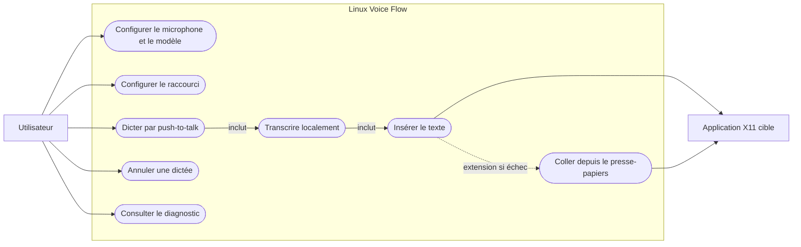
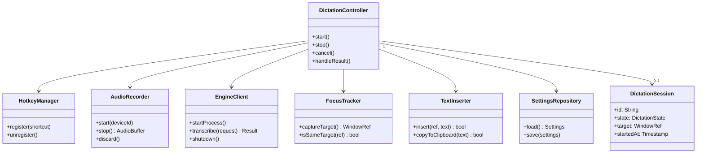
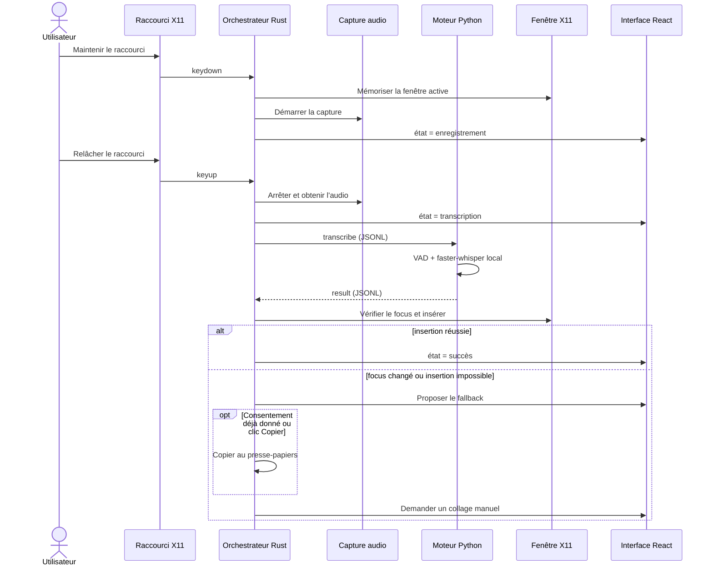
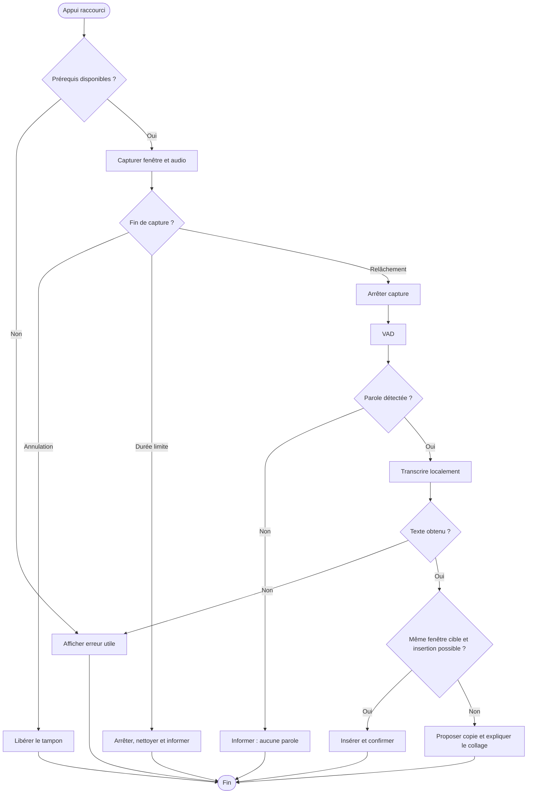
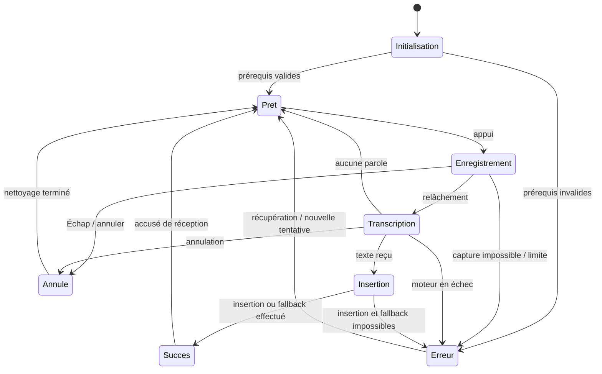
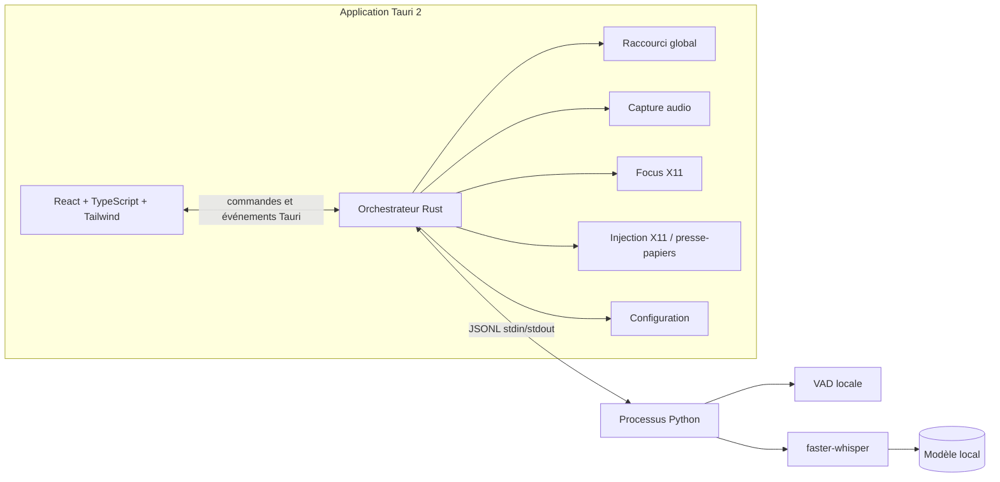
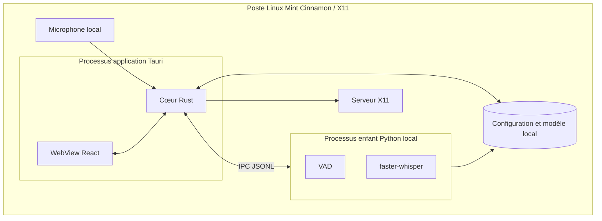
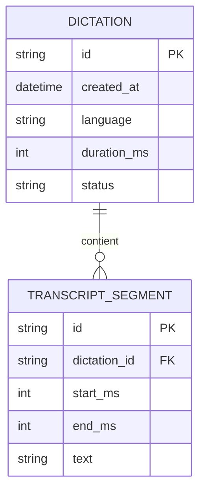

# Cahier des charges — Linux Voice Flow (MVP)

**Version :** 1.1  
**Date :** 4 novembre 2026  
**Statut :** spécification de référence pour implémentation  
**Public :** étudiant M1, Codex, ChatGPT Work et contributeurs techniques

> Ce document décrit un logiciel de dictée vocale pour Linux inspiré du parcours d'usage de Wispr Flow. Il ne revendique aucune affiliation avec ce produit. Les choix marqués **proposition MVP** précisent les points que la demande initiale ne tranchait pas ; ils peuvent être modifiés sans changer l'objectif principal.

> **Extension explicitement demandée le 4 novembre 2026 :** ajouter un mode Groq optionnel, configuré par `GROQ_API_KEY` et `GROQ_MODEL` dans `.env`, avec choix Local/Groq dans l’interface. Dans la suite du document, les garanties de transcription sans compte, sans service distant et sans réseau s’appliquent au **mode local**, proposé par défaut. Le mode Groq envoie l’audio au fournisseur uniquement après sélection et préparation explicites de ce mode. Il conserve le raccourci, la capture locale, les fichiers privés, l’annulation et l’effacement éphémère ; il n’exige aucun poids de transcription local. Il ne bascule jamais automatiquement depuis le local. Aucun secret n’est transmis à l’interface ou placé dans les arguments d’un processus. Une annulation ne retire pas un audio déjà transmis. Cette extension prévaut sur les exclusions générales de cloud ci-dessous pour le seul fournisseur Groq. Contrat d’implémentation : `docs/developpement/plan-groq.md` ; configuration et recette : `docs/groq.md`.

## 1. Résumé et objectif

Linux Voice Flow permet de maintenir un raccourci global, parler, relâcher le raccourci, obtenir une transcription locale, puis insérer le texte dans l'application active. Le logiciel fonctionne sans compte, sans service distant et sans transfert de voix ou de texte sur le réseau. Le poste cible prioritaire est **Linux Mint avec Cinnamon sous X11**.

### 1.1 Objectifs du MVP

1. Dicter en français et en anglais dans une application X11 standard au moyen d'un raccourci **push-to-talk**.
2. Exécuter la capture audio, la détection de voix et la transcription entièrement sur le poste de l'utilisateur.
3. Insérer le texte dans le champ ayant le focus ; proposer une solution par presse-papiers si l'injection directe échoue.
4. Fournir une petite interface pour l'état, les réglages essentiels et les erreurs utiles.
5. Livrer une architecture modulaire et testable, adaptée à un projet académique.

### 1.2 Hors périmètre du MVP

- Prise en charge garantie de Wayland, macOS ou Windows.
- Synchronisation entre appareils, comptes, cloud, télémétrie et mises à jour automatiques réseau.
- Réécriture du texte par modèle génératif, commandes vocales ou traduction.
- Transcription continue en arrière-plan et écoute permanente.
- Historique persistant des enregistrements ou transcriptions.
- Injection dans les champs protégés, terminaux à comportement particulier ou applications qui bloquent l'automatisation.

### 1.3 Hypothèses et décisions proposées

| Sujet | Décision MVP | Justification |
|---|---|---|
| Plateforme | Linux Mint Cinnamon/X11 prioritaire | Réduit la variabilité de la capture du focus, du raccourci global et de l'injection. |
| Raccourci initial | `Ctrl+Alt+Espace`, configurable | Évite une touche dédiée et laisse le choix à l'utilisateur. Vérifier les conflits à l'exécution. |
| Langues | `fr`, `en`, `auto` | Couvre le besoin principal sans multiplier les réglages. |
| Modèle | Modèle faster-whisper local configurable, avec un profil de taille par défaut choisi selon la machine | La qualité et la vitesse dépendent du matériel ; aucun téléchargement silencieux. |
| Téléchargement du modèle | Import manuel ou téléchargement explicite et visible pendant la préparation ; **aucun réseau pendant l'usage de dictée** | Distingue la préparation initiale du fonctionnement local. Pour une distribution strictement hors ligne, fournir un paquet de modèle séparé. |
| Audio temporaire | Capture en mémoire, puis fichier WAV privé et éphémère pour le transport IPC v1 | Rend le protocole implémentable tout en limitant les traces sensibles. |
| Historique | Désactivé | Respecte le principe de minimisation. |
| Injection | Première tentative via X11 ; fallback presse-papiers avec action utilisateur explicite si nécessaire | Préserve la compatibilité sans promettre une insertion universelle. |

## 2. Utilisateurs et parcours

**Utilisateur principal :** personne travaillant sous Linux Mint Cinnamon qui souhaite dicter du texte dans un navigateur, un éditeur ou une application de bureau.

**Parcours nominal :**

1. L'utilisateur lance l'application et vérifie que le modèle local et le microphone sont disponibles.
2. Il place le curseur dans un champ texte d'une application cible.
3. Il maintient le raccourci ; un indicateur discret montre l'enregistrement.
4. Il parle puis relâche le raccourci.
5. Le moteur retire les silences utiles, transcrit et renvoie le texte.
6. L'application insère le texte à l'emplacement visé ou affiche le fallback presse-papiers.
7. Une notification brève confirme le résultat ou explique l'échec.

**Cas limites :** absence de microphone, permission audio refusée, modèle introuvable, parole non détectée, appui très court, raccourci déjà réservé, perte du focus, moteur Python arrêté, transcription vide, application cible fermée, presse-papiers indisponible.

## 3. Exigences fonctionnelles

Chaque exigence possède un identifiant stable pour les tâches et les tests.

| ID | Exigence | Priorité | Critère de validation |
|---|---|---|---|
| F-01 | Détecter l'appui et le relâchement du raccourci global sur Cinnamon/X11. | P0 | Un cycle appui/relâchement lance une seule dictée, même si l'appui est maintenu. |
| F-02 | Permettre de configurer le raccourci et signaler les conflits ou l'échec d'enregistrement. | P0 | Un raccourci invalide ou indisponible produit une erreur lisible et conserve le précédent. |
| F-03 | Capturer l'audio depuis le microphone sélectionné uniquement pendant l'appui. | P0 | L'indicateur passe à « enregistrement » et la capture cesse au relâchement ou à l'annulation. |
| F-04 | Appliquer une VAD locale pour écarter les portions sans parole pertinentes. | P0 | Un enregistrement silencieux ne déclenche aucune insertion. |
| F-05 | Transcrire avec Python et faster-whisper en utilisant un modèle présent localement. | P0 | La dictée fonctionne après coupure du réseau avec le modèle préparé. |
| F-06 | Proposer les langues `fr`, `en` et `auto`. | P1 | La langue choisie est transmise au moteur et conservée au redémarrage. |
| F-07 | Insérer le résultat dans le champ X11 ciblé après la transcription. | P0 | Une phrase dictée apparaît une seule fois dans un éditeur compatible. |
| F-08 | En cas d'échec de l'injection, proposer le fallback presse-papiers et expliquer comment coller. La copie automatique exige un consentement donné dans les réglages. | P0 | Le texte reste récupérable ; le presse-papiers n'est pas écrasé sans consentement. |
| F-09 | Afficher l'état `prêt`, `enregistrement`, `transcription`, `succès` ou `erreur`. | P0 | Les états correspondent aux opérations réelles et ne restent pas bloqués. |
| F-10 | Afficher une erreur exploitable pour microphone, modèle, moteur et injection. | P0 | L'erreur indique une action corrective sans exposer la transcription dans les journaux. |
| F-11 | Permettre de choisir microphone et chemin de modèle local. | P1 | Les choix sont validés, enregistrés et restaurés. |
| F-12 | Annuler une dictée en cours par `Échap` ou via l'interface. | P1 | Aucun texte n'est inséré après annulation ; le tampon audio est libéré. |
| F-13 | Gérer la durée maximale d'une dictée. | P1 | La capture s'arrête proprement à la limite configurée, avec message explicite. |
| F-14 | Afficher un diagnostic local minimal : environnement X11, périphérique audio, modèle et moteur. | P1 | Le diagnostic identifie quel prérequis manque. |
| F-15 | Si un champ secret est identifié par une API d'accessibilité disponible, bloquer l'insertion automatique et avertir l'utilisateur. | P2, hors MVP | Un champ secret détecté ne reçoit pas le texte ; les cas non détectables restent documentés. |

**Règle de focus :** mémoriser l'identifiant de la fenêtre active au début de la capture. Avant insertion, vérifier qu'elle existe toujours et qu'elle est encore active. Si elle a changé ou si la vérification est incertaine, ne pas injecter automatiquement ; proposer le fallback. Un changement de champ **dans la même fenêtre** peut être impossible à détecter par X11 seul : utiliser une information de focus plus précise lorsqu'elle existe, sinon documenter cette limite et permettre à l'utilisateur de désactiver l'insertion automatique.

**Règle de raccourci :** ignorer la répétition de touche et les déclenchements simultanés. Un nouvel appui pendant une transcription ne démarre pas une seconde session. L'interface doit expliquer cet état.

## 4. Exigences non fonctionnelles

| ID | Exigence | Mesure ou seuil de recette |
|---|---|---|
| NF-01 | Confidentialité locale | Après préparation du modèle, aucune requête réseau ne part pendant la capture, la transcription ou l'insertion. Aucun service cloud requis. |
| NF-02 | Minimisation des données | Pas de conservation audio/texte par défaut ; effacement du tampon après succès, erreur ou annulation. |
| NF-03 | Performance | Objectif mesuré, non bloquant pour le MVP : sur la machine de référence documentée, transcription d'une phrase de 10 secondes en moins de 15 secondes après relâchement, avec le modèle par défaut. Publier la configuration et tout écart. |
| NF-04 | Réactivité UI | Changement visuel d'état dans les 300 ms suivant appui/relâchement, hors charge système exceptionnelle. |
| NF-05 | Fiabilité | Un échec du moteur ou de l'injection ne ferme pas l'application et laisse une possibilité de relancer la dictée. |
| NF-06 | Sécurité IPC | Messages validés par schéma, taille bornée, identifiant de requête, timeout, processus enfant sans shell et chemins contrôlés. |
| NF-07 | Accessibilité | États et erreurs lisibles au clavier et par texte ; ne pas dépendre seulement de la couleur. |
| NF-08 | Maintenabilité | Interfaces claires entre UI, orchestration Rust et moteur Python ; fonctions critiques testables sans microphone réel. |
| NF-09 | Distribution | Procédure reproductible de build et d'installation sur Linux Mint Cinnamon/X11. |
| NF-10 | Journalisation | Journaux techniques locaux sans audio ni transcription en clair par défaut ; niveau verbeux activable pour le diagnostic. |
| NF-11 | Robustesse | Timeouts et arrêt propre du moteur ; aucun processus Python orphelin après fermeture normale. |

NF-03 est un **objectif de performance mesuré** ; NF-04 est un **seuil de recette bloquant**. Le rapport de test doit indiquer CPU, RAM, modèle, quantification, durée audio et temps observé.

## 5. Architecture technique

### 5.1 Technologies retenues

| Couche | Technologie | Rôle |
|---|---|---|
| Interface | Tauri 2, React, TypeScript, Tailwind CSS | Fenêtre de réglages, états, messages et diagnostic. |
| Cœur desktop | Rust, commandes et événements Tauri | Cycle de dictée, raccourci global, focus, capture, processus enfant, insertion. |
| Moteur de transcription | Python, faster-whisper, VAD | Chargement du modèle local et transcription. |
| Transport interne | JSON Lines sur `stdin`/`stdout` du processus enfant | Échanges structurés et versionnés entre Rust et Python. |
| Audio | API locale Linux choisie à l'implémentation, par exemple ALSA/PulseAudio/PipeWire via une abstraction Rust | Acquisition du microphone sans réseau. |
| Insertion | API X11 ou outil local encapsulé ; presse-papiers X11 en fallback | Écriture dans la fenêtre cible. |
| Configuration | Fichier local versionné | Langue, raccourci, modèle, périphérique et limites. |

**Frontière de confiance :** React ne lance pas de commande système et ne lit pas directement l'audio. Rust valide toutes les commandes provenant de l'interface. Python ne reçoit que les paramètres nécessaires à la transcription.

### 5.2 Modules proposés

```text
src/                         # Interface React/TypeScript
  app/                        # Vue principale, états et réglages
  features/dictation/         # Composants, hooks et types
  features/settings/
  shared/ipc/                 # Contrats typés côté interface
src-tauri/src/
  app_state.rs                # État global et transitions
  hotkey.rs                   # Raccourci et anti-répétition
  audio.rs                    # Capture et périphériques
  engine.rs                   # Cycle de vie du processus Python
  protocol.rs                 # JSONL, validation et erreurs
  focus.rs                    # Fenêtre cible X11
  insertion.rs                # Injection et presse-papiers
  settings.rs                 # Configuration locale
engine/
  main.py                    # Boucle JSONL
  transcriber.py             # faster-whisper et VAD
  protocol.py                # Schéma, version et erreurs
tests/                        # Tests d'intégration et fixtures audio autorisées
docs/                         # Installation, décisions et résultats de recette
```

Cette arborescence est indicative ; conserver les frontières de responsabilité même si les noms changent.

### 5.3 Contrat IPC JSONL

Une ligne UTF-8 = un objet JSON. `stdout` Python est réservé au protocole ; les diagnostics vont vers `stderr`. Chaque message contient `protocol_version`, `request_id` et `type`. Le processus Rust lance Python sans interpolation de shell et ferme ses flux proprement.

**Contrat v1 proposé :** au démarrage, Python émet `ready` avec `protocol_version: 1` et `request_id: "startup"` après chargement du modèle, ou une erreur explicite. Rust attend cette réponse pendant 60 secondes. Une seule transcription peut être en cours ; les requêtes suivantes sont refusées avec `ENGINE_BUSY`. Chaque ligne JSONL est limitée à 1 Mio. Une transcription expire après 120 secondes ; Rust invalide alors son `request_id`, termine puis redémarre le moteur si nécessaire. Une réponse tardive ou d'identifiant inconnu est ignorée et journalisée sans texte. Pour annuler, Rust envoie `cancel` avec le même identifiant ; si le moteur ne confirme pas dans les 3 secondes, Rust le termine. Les constantes sont configurables dans le code et couvertes par des tests.

Exemple de requête :

```json
{"protocol_version":1,"request_id":"d-001","type":"transcribe","audio_path":"/chemin/temporaire/prive/d-001.wav","language":"fr","model_path":"/chemin/local/model","vad":true}
```

Exemple de succès :

```json
{"protocol_version":1,"request_id":"d-001","type":"result","text":"Bonjour, ceci est un essai.","language":"fr","duration_ms":2300}
```

Exemple d'erreur :

```json
{"protocol_version":1,"request_id":"d-001","type":"error","code":"MODEL_NOT_FOUND","message":"Modèle local introuvable"}
```

**Transport audio v1 :** Rust capture d'abord dans un tampon mémoire, puis écrit un WAV dans un répertoire temporaire privé (`0700`) avec permissions `0600`. Le chemin est envoyé à Python via `audio_path`. Python lit le fichier sans le modifier ; Rust en reste propriétaire et le supprime après résultat, erreur, timeout ou annulation. Un nettoyage au démarrage traite les fichiers laissés par un crash. Cette fenêtre de présence sur disque doit être signalée dans la documentation de confidentialité. Une évolution future pourra utiliser un flux binaire dédié pour supprimer cette étape ; ne jamais encoder un gros audio en JSONL sans justification.

**Erreurs normalisées minimales :** `MIC_UNAVAILABLE`, `NO_SPEECH`, `MODEL_NOT_FOUND`, `MODEL_LOAD_FAILED`, `ENGINE_BUSY`, `ENGINE_TIMEOUT`, `ENGINE_CRASHED`, `FOCUS_CHANGED`, `INJECTION_FAILED`, `CLIPBOARD_FAILED`, `CANCELLED`, `PROTOCOL_ERROR`.

## 6. Diagrammes UML et architecture (Mermaid)

Mermaid ne propose pas toutes les notations UML natives. Les cas d'utilisation, activités, composants et déploiement ci-dessous emploient des graphes Mermaid avec des relations UML explicites.

### 6.1 Cas d'utilisation



### 6.2 Classes / responsabilités



### 6.3 Séquence nominale



### 6.4 Activités



### 6.5 États de dictée



### 6.6 Composants



### 6.7 Déploiement



## 7. Données et configuration

Le MVP n'exige pas de base de données. Un fichier de configuration versionné suffit. Exemple conceptuel :

```json
{
  "schema_version": 1,
  "shortcut": "Ctrl+Alt+Space",
  "language": "fr",
  "microphone_id": "default",
  "model_path": "/chemin/local/vers/modele",
  "max_recording_seconds": 60,
  "clipboard_fallback": true
}
```

**Règles :** valider les valeurs au chargement ; conserver une configuration précédente si une mise à jour échoue ; ne jamais y stocker l'audio ou la transcription ; documenter l'emplacement réel du fichier et ses permissions.

Schéma relationnel **optionnel, hors MVP**, seulement si un historique activable devient nécessaire :



Un futur historique doit être **désactivé par défaut**, explicitement consenti, effaçable et documenté. Il n'entre pas dans la recette du MVP.

## 8. Confidentialité et sécurité

- La préparation du modèle doit être explicite. Le mode de dictée n'utilise aucun endpoint réseau.
- Ne pas enregistrer les sons, transcriptions ou contenus du presse-papiers dans les logs. Masquer les chemins personnels lorsque possible dans les rapports partageables.
- Limiter le temps de rétention du texte dans l'interface. Le presse-papiers est une zone système partagée : informer l'utilisateur qu'une autre application peut y accéder et offrir un effacement manuel.
- Lors du fallback, demander le consentement dans les réglages avant toute copie automatique. Sans consentement, afficher le texte et un bouton « Copier ». Ne pas restaurer automatiquement l'ancien contenu si cela risque d'écraser une copie effectuée entre-temps.
- Ne pas exécuter de commande shell construite depuis un texte dicté, un chemin ou un paramètre d'interface.
- Vérifier l'existence et les permissions des chemins de modèle et fichiers temporaires. Éviter les répertoires partagés accessibles à d'autres utilisateurs.
- Détruire le processus enfant et les fichiers temporaires à la fermeture et après timeout. Prévoir un nettoyage au prochain démarrage pour les fichiers abandonnés après crash.
- Expliquer clairement que certaines applications X11 ou champs secrets peuvent empêcher la détection fiable du type de champ ; offrir un réglage de désactivation temporaire de l'insertion automatique si nécessaire.

## 9. Roadmap et découpage en tâches

Les tâches sont ordonnées pour produire un incrément testable à chaque étape. Une tâche ne doit pas modifier les contrats voisins sans mettre à jour les schémas et tests concernés.

| Lot | Tâche | Livrable vérifiable | Dépendances |
|---|---|---|---|
| T-01 | Initialiser Tauri 2 + React + TypeScript + Tailwind et documenter le build Linux Mint. | Application lançable, fenêtre et commandes de base. | Aucune |
| T-02 | Définir l'état de dictée, les types d'événements et le protocole JSONL version 1. | Contrat partagé et tests de parsing/validation. | T-01 |
| T-03 | Créer le moteur Python faster-whisper avec chargement local, VAD et erreurs normalisées. | CLI JSONL testable avec audio de fixture. | T-02 |
| T-04 | Intégrer le processus Python côté Rust avec timeout et fermeture propre. | Transcription de fixture depuis Tauri. | T-02, T-03 |
| T-05 | Ajouter microphone, capture push-to-talk et limite de durée. | Capture et annulation observables ; pas d'enregistrement au repos. | T-01, T-02 |
| T-06 | Prototyper d'abord la réception distincte de l'appui et du relâchement global sur Cinnamon/X11, puis ajouter raccourci configurable et conflits. | Appui/relâchement stable et démontré avant l'intégration de la dictée. | T-01 |
| T-07 | Ajouter suivi de fenêtre, insertion X11 et fallback presse-papiers. | Texte inséré dans deux applications cibles ou récupérable par collage. | T-04, T-06 |
| T-08 | Créer UI d'état, réglages, erreurs et diagnostic. | Parcours complet utilisable au clavier. | T-04 à T-07 |
| T-09 | Durcir confidentialité, permissions, nettoyage et journalisation. | Vérifications de sécurité et absence de traces sensibles par défaut. | T-03 à T-08 |
| T-10 | Exécuter recette, corriger les défauts et préparer le paquet/documentation. | Rapport de test, guide d'installation et paquet MVP. | T-01 à T-09 |

### 9.1 Jalons

1. **J1 — Socle :** T-01 à T-04 ; une fixture audio est transcrite via l'application.
2. **J2 — Dictée réelle :** T-05 à T-07 ; le texte arrive dans une application X11.
3. **J3 — MVP livrable :** T-08 à T-10 ; réglages, sécurité et recette validés.

### 9.2 Consignes d'implémentation pour Codex et ChatGPT Work

1. Lire ce document en entier avant de modifier le projet. Relever les exigences et IDs touchés par la tâche.
2. Examiner le dépôt, ses instructions locales (`AGENTS.md`, `.agent/`, README) et ses conventions avant de choisir les fichiers. Les instructions explicites de l'utilisateur priment.
3. Traiter une tâche du tableau à la fois ou un groupe cohérent avec dépendances satisfaites. Écrire un court plan technique avant un changement majeur.
4. Garder les frontières UI/Rust/Python. Ne pas faire passer la capture audio ou les accès X11 dans React.
5. Versionner le protocole JSONL et valider les messages aux deux extrémités. Toute évolution de schéma doit inclure des tests de compatibilité utiles.
6. Construire les dépendances et le modèle de manière reproductible. Ne jamais télécharger un modèle silencieusement ni déclencher un service distant pendant la dictée.
7. Tester les erreurs autant que le parcours heureux : modèle absent, silence, raccourci indisponible, moteur arrêté, focus changé, fallback presse-papiers.
8. À la fin de chaque tâche, indiquer fichiers modifiés, exigence satisfaite, commandes de vérification réellement exécutées, résultat et limites restantes. Ne pas déclarer une fonction prête sur la seule base d'une compilation.
9. Pour tout changement de périmètre, signaler la décision et mettre à jour ce document, les diagrammes et la recette correspondante.

## 10. Tests et critères de recette

### 10.1 Environnement de référence

Consigner : version de Linux Mint, session Cinnamon/X11, CPU, RAM, moteur audio, version de Python, version du paquet, modèle local, langue et microphone. Effectuer les tests d'insertion avec **au moins un éditeur de texte et un champ de navigateur**.

### 10.2 Matrice de tests

| ID | Scénario | Résultat attendu | Exigences |
|---|---|---|---|
| R-01 | Appui, parole claire, relâchement dans éditeur X11. | Une transcription unique apparaît au curseur ; état revient à prêt. | F-01, F-03 à F-05, F-07, F-09 |
| R-02 | Même parcours dans un navigateur X11. | Texte inséré une seule fois ou fallback explicitement présenté. | F-07, F-08 |
| R-03 | Dicter avec réseau désactivé après préparation. | Transcription et insertion fonctionnent ; aucun appel réseau nécessaire. | F-05, NF-01 |
| R-04 | Maintenir le raccourci sans parler. | Aucune insertion ; indication « aucune parole ». | F-04 |
| R-05 | Changer le focus pendant la transcription. | Aucune injection automatique dans la nouvelle fenêtre ; texte récupérable par collage. | F-07, F-08 |
| R-06 | Simuler échec d'injection X11 avec et sans consentement à la copie automatique. | Avec consentement, le presse-papiers reçoit le texte ; sans consentement, il reste intact et l'UI offre « Copier » puis explique comment coller. | F-08 |
| R-07 | Retirer ou désactiver le microphone. | Erreur utile ; application reste ouverte et récupérable. | F-03, F-10, NF-05 |
| R-08 | Définir un modèle absent ou corrompu. | Erreur normalisée, aucune requête réseau ni crash UI. | F-05, F-10 |
| R-09 | Réserver le raccourci ailleurs puis le configurer. | Conflit signalé ; ancien raccourci conservé. | F-02 |
| R-10 | Annuler avant relâchement et pendant transcription. | Aucune insertion ; tampon et ressources nettoyés. | F-12, NF-02 |
| R-11 | Dépasser la durée maximale. | Arrêt propre et message ; aucune capture interminable. | F-13 |
| R-12 | Arrêter brutalement Python pendant une requête. | Erreur claire, retour à un état utilisable, aucun processus orphelin. | F-10, NF-05, NF-11 |
| R-13 | Redémarrer après modification des réglages. | Langue, microphone, modèle et raccourci restaurés ou erreur de validation claire. | F-02, F-06, F-11 |
| R-14 | Inspecter logs et répertoire temporaire après succès/erreur. | Ni audio ni texte dicté persistés par défaut ; fichiers temporaires supprimés. | NF-02, NF-10 |
| R-15 | Mesurer la réactivité et la durée de transcription. | Résultats consignés avec machine et modèle ; NF-04 atteint, NF-03 atteint ou écart mesuré et expliqué. | NF-03, NF-04 |
| R-16 | Changer de champ dans la même fenêtre pendant la transcription. | Si le changement est détectable, aucun texte n'est inséré dans le nouveau champ ; sinon la limite est documentée et le réglage de désactivation de l'insertion automatique est vérifié. | F-07, F-08 |

### 10.3 Niveaux de test attendus

- **Unitaires :** transitions d'état, validation de configuration, validation JSONL, gestion du silence, politique de focus et choix du fallback.
- **Intégration :** Rust ↔ Python avec fixture audio, timeout et crash simulé ; capture et insertion sur session X11 de test lorsque possible.
- **Manuels :** raccourci global, microphone réel, focus, presse-papiers, accessibilité et fonctionnement hors ligne sur Linux Mint Cinnamon/X11.
- **Sécurité/confidentialité :** inspection des logs, fichiers temporaires, permissions et trafic réseau pendant une dictée.

Les fixtures audio doivent être libres de droits ou enregistrées par l'équipe avec consentement ; aucune voix d'utilisateur réel ne doit entrer dans le dépôt sans accord explicite.

## 11. Definition of Done

Une tâche est terminée lorsque :

1. Ses critères du tableau de tâches et les exigences associées sont satisfaits.
2. Le code compile et les tests pertinents passent sur l'environnement disponible ; les commandes et résultats sont consignés.
3. Les erreurs prévisibles ont un comportement défini et vérifié.
4. Aucun audio ou texte transcrit n'est persisté ou transmis sans action explicite de l'utilisateur.
5. Les contrats, réglages et instructions d'installation touchés sont documentés.
6. Les limitations connues et les écarts de performance sont rapportés sans les masquer.

Le **MVP global** est terminé lorsque R-01 à R-10, R-12 à R-14 et R-16 sont validés sur Linux Mint Cinnamon/X11, que R-15 satisfait NF-04 et documente NF-03, et que les exigences P0 sont toutes satisfaites. R-11 couvre F-13, classée P1 : si cette fonction est reportée, imposer une limite de sécurité fixe et documentée avant livraison. Les autres exigences P1 reportées sont explicitement signalées avec leur impact utilisateur. Une démonstration hors ligne montre le parcours complet, y compris le fallback presse-papiers.

## 12. Risques et arbitrages

| Risque | Effet | Mesure |
|---|---|---|
| X11 expose des comportements variables selon l'application. | Injection ou lecture du focus incertaine. | Tests sur deux cibles, vérification du focus et fallback manuel. |
| Modèle lourd sur machine modeste. | Latence ou consommation mémoire élevée. | Profil de modèle configurable et mesure sur machine de référence. |
| Capturer/relâcher le raccourci global est délicat selon la bibliothèque. | État d'enregistrement bloqué. | Prototype technique très tôt, timeout de capture et bouton Annuler. |
| Le presse-papiers peut contenir des données sensibles. | Remplacement du contenu et accès par d'autres applications. | Notification claire, action d'effacement et pas de restauration automatique risquée. |
| Un crash peut laisser un fichier audio temporaire. | Trace sensible sur disque. | Préférer la mémoire ; répertoire privé et nettoyage au démarrage. |
| Les performances de VAD et transcription varient selon l'accent et le bruit. | Qualité inégale. | Jeu de fixtures francophones/anglophones, réglages simples et limites documentées. |

## 13. Livrables attendus

- Code source Tauri/React/TypeScript/Tailwind/Rust et moteur Python.
- Contrat IPC JSONL versionné et documentation d'architecture.
- Instructions d'installation, de préparation du modèle et d'utilisation hors ligne.
- Tests automatisés utiles et rapport de recette manuel sur Linux Mint Cinnamon/X11.
- Paquet ou procédure de build reproductible, avec les dépendances locales décrites.
- Liste des limitations connues et des pistes hors MVP (Wayland, historique optionnel, modèles supplémentaires).
